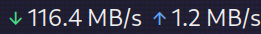
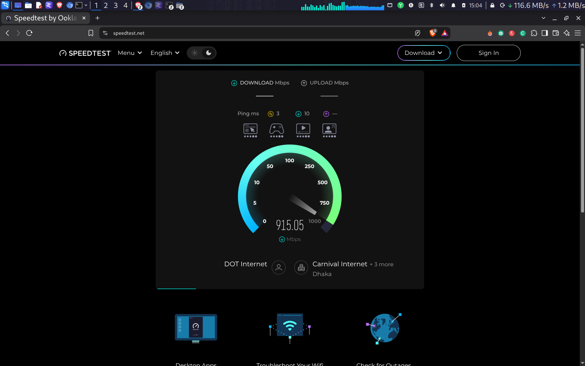
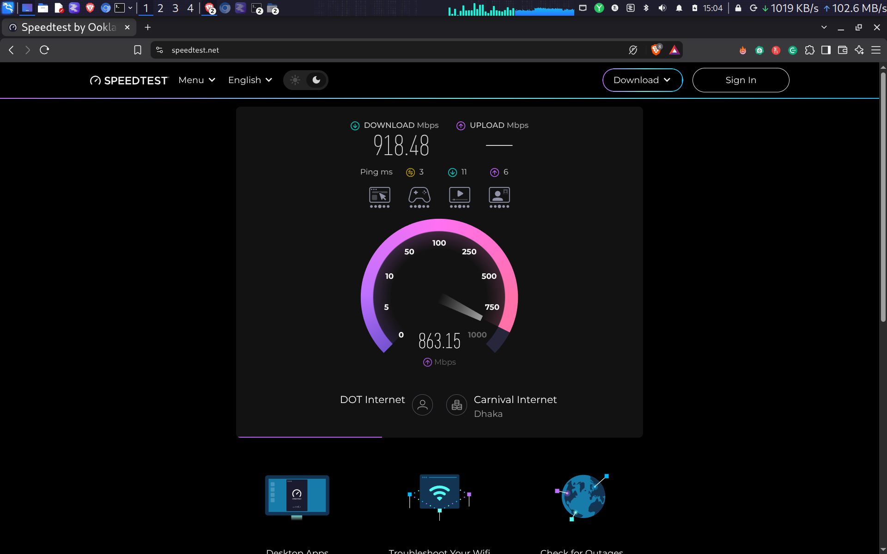
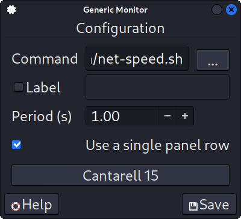

# NetSpeedMonitor XFCE

<p align="center">
  
</p>

[](https://github.com/aaprince6/netspeedmonitor-xfce/actions/workflows/ci.yml)
[](LICENSE)
[](https://www.gnu.org/software/bash/)

A lightweight, Windows-style real-time network speed indicator for the **XFCE panel**. It displays combined download and upload rates using Bash and the XFCE Generic Monitor (Genmon) plugin.

## Screenshots

<p align="center">
  
  
</p>
<p align="center">
  
  
</p>

| Download | Upload |
|:--:|:--:|
| Green ↓ | Blue ↑ |

## Target operating systems

**Primary target:** Kali Linux Rolling with the XFCE desktop.

| Operating system | Support status | Notes |
|---|---|---|
| Kali Linux Rolling (XFCE) | Primary target | Main development and user testing platform |
| Debian 12 or newer (XFCE) | Supported | Install `xfce4-genmon-plugin` from APT |
| Ubuntu 22.04 LTS or newer (XFCE) | Supported | Install `xfce4-genmon-plugin` from APT |
| Other Linux distributions with XFCE | Expected to work | Requires Bash, standard core utilities, Linux network statistics and Genmon |

This is an **XFCE panel applet/script**, not a standalone desktop application. The panel display requires XFCE and the Generic Monitor plugin. Other desktop environments are not currently supported.

## Features

- Live download and upload speeds, refreshed by Genmon.
- Sums traffic across eligible physical/network-device-backed interfaces by default.
- Automatically discovers adapters; no hard-coded `eth0` or `wlan0`.
- Human-readable B/s, KB/s and MB/s units.
- Colored download/upload indicators and an informative hover tooltip.
- Configurable virtual-interface inclusion and interface exclusions.
- Runs as the current user; root access is not required.
- Lightweight Bash implementation with no background daemon.

## Requirements

- Linux kernel exposing network counters in `/sys/class/net`.
- XFCE desktop and panel.
- Bash, `awk`, `date`, and standard core utilities.
- `xfce4-genmon-plugin`.

On Kali Linux, Debian or Ubuntu:

```bash
sudo apt update
sudo apt install xfce4-genmon-plugin
```

## Installation

```bash
git clone https://github.com/aaprince6/netspeedmonitor-xfce.git
cd netspeedmonitor-xfce
chmod +x install.sh uninstall.sh
./install.sh
```

The installer places the executable at `~/.local/bin/netspeed-xfce` (or `$XDG_BIN_HOME/netspeed-xfce` when `XDG_BIN_HOME` is set).

## Add the monitor to the XFCE panel

1. Right-click the XFCE panel.
2. Select **Panel → Add New Items**.
3. Add **Generic Monitor**.
4. Open the new item's **Properties**.
5. Set **Command** to the installed script path, usually:

   ```text
   /home/YOUR_USERNAME/.local/bin/netspeed-xfce
   ```

6. Set the update period to **1 second**.
7. Close the dialog. The first sample may show zero; rates appear after the next refresh.

Replace `YOUR_USERNAME` with your Linux username. You can verify the script from a terminal:

```bash
~/.local/bin/netspeed-xfce
sleep 1
~/.local/bin/netspeed-xfce
```

The script prints Genmon's `<txt>` and `<tool>` markup. It is intended to be run by Generic Monitor, not as a standalone terminal dashboard.

## Configuration

The monitor discovers interfaces automatically. By default, it counts interfaces with a device link at `/sys/class/net/INTERFACE/device`. This normally includes physical Ethernet, Wi-Fi and USB network adapters while excluding loopback and many virtual interfaces.

| Environment variable | Default | Description |
|---|---:|---|
| `NETSPEED_INCLUDE_VIRTUAL` | `0` | Set to `1` to include interfaces without a physical device backing |
| `NETSPEED_EXCLUDE_IFACES` | `lo` | Space-separated interface names to exclude |

Example Genmon command to include virtual interfaces but exclude Tailscale:

```bash
NETSPEED_INCLUDE_VIRTUAL=1 NETSPEED_EXCLUDE_IFACES="lo tailscale0" /home/YOUR_USERNAME/.local/bin/netspeed-xfce
```

Keep the same environment settings on every refresh so rate calculations remain consistent.

### How totals are calculated

The monitor sums kernel receive/transmit byte counters for the selected interfaces. This is **not** a deduplicated measurement of internet traffic. In bridges, routers, bonds or forwarding configurations, the same packets may be counted on more than one interface. Results depend on network topology and driver counter semantics.

## Troubleshooting

### Genmon displays no output

```bash
ls -l ~/.local/bin/netspeed-xfce
~/.local/bin/netspeed-xfce
dpkg -l | grep xfce4-genmon-plugin
```

Confirm that the Generic Monitor command points to the installed script and that it is executable.

### Speeds remain at zero

Generate network traffic and wait for at least two refreshes. Check interface state and kernel counters:

```bash
ip -br link
cat /sys/class/net/INTERFACE/statistics/rx_bytes
cat /sys/class/net/INTERFACE/statistics/tx_bytes
```

Replace `INTERFACE` with the actual interface name.

### An interface is missing

Check whether it has a device link:

```bash
ls -l /sys/class/net/INTERFACE/device
```

If it is virtual, set `NETSPEED_INCLUDE_VIRTUAL=1` and configure exclusions as needed.

## Uninstall

From the cloned project directory:

```bash
./uninstall.sh
```

Then remove the Generic Monitor item manually from the XFCE panel.

## Development and contributions

Bug reports and pull requests are welcome. Before submitting changes, run:

```bash
bash -n src/netspeed-xfce.sh install.sh uninstall.sh
```

For bug reports, include your distribution/version, XFCE version, Genmon version, interface type and relevant command output. Remove public IP addresses and other sensitive information.

See [CONTRIBUTING.md](CONTRIBUTING.md) and [SECURITY.md](SECURITY.md).

## License

Distributed under the [MIT License](LICENSE).
